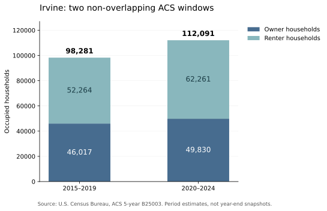

# 需求：家庭结构与购买力｜阶段三

研究日期：2026-10-11（America/Los_Angeles）。独立公共市场B；本轮为城市家庭结构及购买力代理指标，不含私人家庭财务，也未形成完整买入／等待结论。

## 一、目前最支持的判断

Irvine有规模可观的高收入家庭和高收入租客；但两个不重叠ACS窗口之间，家庭数量增加主要体现为租客存量增加。四城有未成年人家庭的占比均约三分之一，Irvine的点估计并没有明显高于替代城市。人口／家庭增长、高收入居民存量、准备购买高价四卧的家庭，是三件不同的事。

这些证据支持继续检验租转买、换房和外来买家承接能力；不足以证明目标房型会长期供不应求，也不能由城市中位收入反推某套房的公允价格。后续须接入社区边界、目标产品、实际成交与融资证据。

## 二、版本与可比性先冻结

2025 ACS一年数据尚未发布：Census当前更新页仍列发布日期待确定。本轮取得2024一年表（2025-09-11发布）、2020–2024五年表（2026-01-29发布），以及2015–2019五年表。四城统一比较采用五年表；一年表另列，不与五年表相减。五年表是期间估计，不是2024-12-31快照，也不代表五年累计迁入／累计成交。

Aliso Viejo未出现在标准一年地理文件中。Lake Forest和Tustin虽有标准一年表，本次B07001／B07010全国官方下载文件中仍没有这两城对应行；记录为表级不可得，不补零，不拿五年值冒充一年值。2019旧格式GEOID按明确规则补齐当前格式，再用地理名称、州、Summary Level、Component和LOGRECNO核对。城市代码相同不保证历年边界完全不变；边界统一和控制人口修订仍是历史解释限制。

## 三、四城家庭结构：共同五年窗口

| 城市 | 家庭总数 | 业主占比 | 有未成年人家庭 | 收入≥$200k家庭 |
| --- | --- | --- | --- | --- |
| Irvine | 112,091 ±1,501 | 44.5% ±1.2pp | 33.6% ±1.4pp | 32.3% ±1.3pp |
| Lake Forest | 30,466 ±686 | 70.5% ±2.2pp | 33.3% ±2.2pp | 31.3% ±2.1pp |
| Tustin | 27,551 ±746 | 48.8% ±2.2pp | 33.2% ±2.4pp | 25.5% ±2.3pp |
| Aliso Viejo | 19,633 ±594 | 56.7% ±2.8pp | 33.3% ±2.5pp | 30.1% ±2.4pp |

所有“±”为90%抽样误差范围；pp为百分点。家庭总数使用发布的MOE，后三列比例使用80次方差重复估计SDR计算，纳入分子与分母的协方差。有未成年人表示家中至少一人未满18岁，包含非亲生子女等关系；与后文“户主自己的子女”口径不同。

Irvine业主占比约44.5%，低于Lake Forest约70.5%；这首先描述住房存量和居住结构，不能单独解释为买家不足。Irvine≥$200k家庭占比约32.3%，与Lake Forest约31.3%、Aliso Viejo约30.1%的差距较小，误差范围重叠；不能排列出确定的购买力名次。Irvine年轻户主及租客较多，学生、职业流动、住房供给形态都可能参与形成这种结构。

| 城市 | 年龄中位数 | 25–44岁户主占比 | 业主收入中位数 | 租客收入中位数 |
| --- | --- | --- | --- | --- |
| Irvine | 34.0 ±0.5 | 42.3% ±1.7pp | $181,961 ±$6,351 | $113,008 ±$5,873 |
| Lake Forest | 40.2 ±1.1 | 33.1% ±2.7pp | $158,319 ±$7,096 | $90,961 ±$8,061 |
| Tustin | 37.5 ±1.3 | 38.3% ±2.9pp | $158,770 ±$10,132 | $84,680 ±$7,278 |
| Aliso Viejo | 39.2 ±0.9 | 34.5% ±3.4pp | $175,256 ±$12,973 | $109,973 ±$15,679 |

Irvine年龄中位数34.0岁，25–44岁户主占比42.3%（近似MOE±1.7pp）。这是一种居住结构，并不等于对应家庭正在形成首付或准备买房。收入均为2024通胀调整美元，属于ACS现金收入口径，不是资产净值、可动用首付或银行核定收入；资本利得、借款、资产变现等不能由此完整推断。已有业主还可能持有低利率贷款与长期房屋净值，不能用其收入直接代表今天首次购入所需的收入。

## 四、家庭增量：租客、业主、有孩分别看

| 城市 | 家庭总数变化 | 业主户数变化 | 租客户数变化 | 有未成年人家庭变化 |
| --- | --- | --- | --- | --- |
| Irvine | +13,810 ±1,945 | +3,813 ±1,793 | +9,997 ±2,112 | +3,049 ±1,525 |
| Lake Forest | +1,128 ±898 | +1,134 ±1,059 | -6 ±860 | +136 ±685 |
| Tustin | +1,854 ±1,009 | +683 ±969 | +1,171 ±885 | -718 ±618 |
| Aliso Viejo | +1,118 ±688 | +2 ±774 | +1,116 ±727 | -462 ±492 |

比较2015–2019与2020–2024两个不重叠窗口。Irvine总户数98,281→112,091，增加13,810±1,945；租客52,264→62,261，增加9,997±2,112；业主46,017→49,830，增加3,813±1,793。点估计中，租客户数变化约占总户数变化72.4%。这是两个期间存量的变化贡献，不是新增家庭流入比例、年度增长率、租转买概率，也不是新建住房的租赁比例。

*图：Irvine租客和业主家庭存量，两个不重叠ACS五年窗口。原始统计来源：U.S. Census Bureau，B25003；窗口不能视为年末快照。*

Irvine有未成年人家庭34,612→37,661，增加3,049±1,525；占比35.2%→33.6%，点估计下降1.62pp，差值MOE约±1.50pp，属于边缘的90%名义显著结果，不能据此断言稳定的结构性下滑。家庭户占比及65岁以上户主占比的变化没有足够证据排除抽样波动。多个比较未经多重检验校正，不用单个接近门槛的p值决定购房。

Aliso Viejo租客点估计增加1,116户，业主仅增加2户，后者远小于误差；不能写成业主实际没有增长。Lake Forest有未成年人家庭增加136±685户，未能排除零变化。ACS与DOF的时点、期间、控制和估计方式不同，不能以其中一表强行覆盖另一表；这也说明上一轮DOF已入住户近乎固定的城市仍需要独立核对。

## 五、购买力：可见收入存量，买家交集尚未识别

Irvine五年窗口约有36,220 ±1,425户收入≥$200k；收入≥$150k的租客21,710 ±1,268户，占租客34.9% ±1.8pp。有户主自己的未成年子女的租客17,811 ±1,309户，占租客28.6% ±2.0pp。后两项来自已交叉的租买／收入、租买／子女表，误差采用标注的近似法。

不能把收入占比、租客占比、孩子占比与年龄占比相乘来制造“目标买家数量”：它们不是独立变量。这些表没有给出“高收入＋租客＋有孩＋首付充足＋愿意买指定房型”的联合交集；B19001最高收入档为≥$200k，B25118最高档为≥$150k，也无法分出$300k或$500k收入家庭。不得把所有高收入家庭视为新增买家：其中包括已有业主、长期选择租住者、不同房型需求及同一家庭重复出现在不同边际统计中。

2024一年表另显示Irvine家庭115,091 ±3,415户，≥$200k收入占比34.8% ±2.5pp。该结果可补充较近时期的结构，但不能与五年点估计相减得出最近一年新增买家。未以不同美元基准的2019与2024收入直接计算实际购买力增长。

## 六、迁入结构：不等于净迁移，也不等于富裕买家

Irvine 2024一年表中，现居居民上一年从加州其他县迁来14,791±2,655人，从其他州迁来7,241±2,901人，从境外迁来8,535±2,401人；这里是1岁及以上的人，不是家庭。县内搬家包括同一城市内换住处，不能全部当成外来需求。境外原居地不等于移民身份；以上都是当前居民的迁入侧，没有迁出侧，不能计算城市净迁移。五年表同类字段仍是期间内“过去一年居住地”估计，不把它乘五当五年总量。

B07011收入是15岁以上且有收入者的个人收入，不是家庭收入。Irvine一年表中，原居加州其他县的人个人收入中位数$11,402±$4,085，从其他州迁来者$72,343±$13,791，从境外迁来者$26,348±$12,910。未分层学生、就业、年龄与家庭成员，也不测资产，不能据此声称迁入者更富裕或更贫穷。Lake Forest／Aliso Viejo部分境外迁入收入单元被官方标注不可计算，保留空值。

## 七、验收、限制与下一动作

本轮49个官方数值／地理／元数据来源文件均保存完整字节指纹：2024为32份，2019为11份，VRE为6份。标准细项2024为2,781行、2019为1,725行，共4,506行；常规指标305＋60行、跨窗口比较60行、重复估计指标25行。195个关键E／MOE单元在另一份官方发布格式中逐项一致。表级缺失、特殊值和误差口径均已登记。验证算术、地理身份和提取一致，不验证调查无误或市场因果。

缺口仍包括：社区精细边界与Census tract叠加；高收入、有孩、年龄、资产与买房意愿的联合交集；流入／流出、实际购房融资与目标产品承接；成交试样本仍0/20–30、人工成交核对0/5。HMDA、IRS流向、学校、项目兑现与资产定价未验收。此阶段未冒充完整公共B或独立Astra复核。

下一动作：完成Stonegate、Orchard Hills及Reserve子区的社区边界与2020 Census tract/GEOID叠加，登记整块／部分重合及人口分配误差，不能把PA9或跨城市PUMA全部当作Stonegate。随后再把目标产品成交与融资数据接到购买力分析。

## 八、主要来源与复算

[Census 2026 ACS更新与2025发布状态](https://www.census.gov/programs-surveys/acs/news/updates.html)

[2024官方Summary File与下载入口](https://www.census.gov/programs-surveys/acs/data/summary-file.2024.html)

[2019官方Sequence-Based Summary File](https://www.census.gov/programs-surveys/acs/data/summary-file/sequence-based/2019.html)

[2024数据比较规则](https://www.census.gov/programs-surveys/acs/guidance/comparing-acs-data/2024.html)

[2024方差重复估计及技术说明](https://www.census.gov/programs-surveys/acs/data/variance-tables/2024.html)

[ACS收入概念](https://www2.census.gov/programs-surveys/acs/tech_docs/subject_definitions/2024_ACSSubjectDefinitions.pdf)

复算顺序：python scripts/build_acs_household_structure.py --download；python scripts/refine_acs_moe.py --download；python scripts/build_acs_history.py --download；python scripts/report_acs_structure.py。原始文件指纹变化时停止并登记新版本；下载首次耗时较长，后续使用已核对的缓存。公开仅统计摘取、指纹、脚本、QA与原创分析，原始文件包及私人入口不写进公开仓库。
