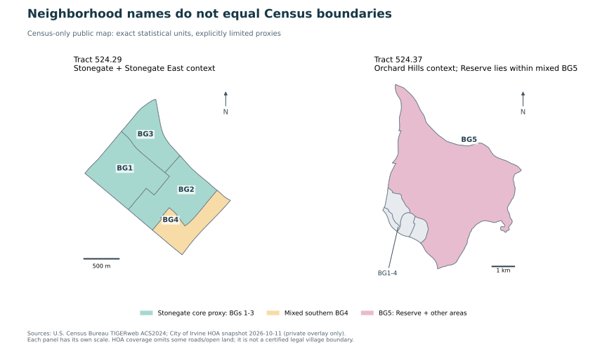
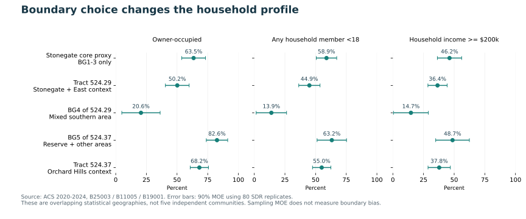

# 需求：社区边界与画像｜阶段四

研究日期：2026-10-11（America/Los_Angeles）。独立公共市场B；只使用公开来源。本轮完成可复算的空间口径与统计代理区诊断，尚未取得精确Reserve家庭画像或买入／等待结论。

## 一、最重要的结果

已经取得Stonegate、Stonegate East、Groves、Orchard Hills Village II与Reserve的市政府HOA覆盖多边形，并与Census地理单元匹配。冻结的是可追溯的研究覆盖范围，不是对产权、法律边界或完整市场社区的认证。HOA图层包含公寓子区，也可能排除公路、学校、空地及未纳入范围。

不能把整个524.37 tract或其BG5的收入贴给Reserve。Reserve覆盖范围全部位于BG5，但BG5同时覆盖Groves部分及大片其他土地；2020住房街区也显示两个社区的住宅混在这个单元内。继续缩小到人口普查block仍无法取得同尺度的ACS收入。

Stonegate可使用完整BG1–3作为明确命名的主体代理区，同时另列BG4混合区。主体代理自有住房占比63.5%±9.7pp，有未成年人家庭58.9%±8.3pp；混合tract对应为50.2%±9.7pp和44.9%±8.7pp。差异说明口径敏感，不能择取更合偏好的边界来代表整个Stonegate。

## 二、社区名称与统计边界

| 对象 | 冻结口径 | Census 对应 | 可解释范围 |
|---|---|---|---|
| Stonegate | MASTER_ID 9.4；9个HOA要素合并 | 06059052429；BG1–4 | 有独立覆盖范围；BG4与Stonegate East混合 |
| Stonegate East | MASTER_ID 9.3；4个要素合并 | 060590524294 | 独立保留，不能随PA9一并当Stonegate |
| Orchard Hills | 父PA1；另列Groves与Village II | 主体在06059052437，PA1还跨其他tract | 父规划区、市场社区、已建住宅覆盖范围不同 |
| Reserve | MASTER_ID 1.3；OBJECTID 336 | 060590524375 | 全部落入BG5；BG5同时含Groves部分，不能单独识别Reserve |

修正前轮PA对照的使用方式：规划文件把9B与9C2列在Stonegate名称下，但本轮市政府HOA属性明确区分Stonegate Village（9.4）与Stonegate East（9.3）。原PA映射只作规划父区索引，不能据此把两者合为市场社区。实际查询属性是依据，图层旧图例名称不能替代当前要素属性。

HOA快照取得于2026-10-11；Reserve要素EditDate为2025-06-11 UTC，Stonegate选中要素的最新编辑为2026-09-29 UTC。PA图层描述仍写2021年，数据编辑时间是2022-08-24 UTC，不能把检索日当作边界生效日。Census采用2020 tract/BG定义在ACS2024服务中的几何；两处目标tract的2020与2024边界已用对称差核查。

图1｜市政府HOA覆盖范围与Census tract/BG。左右比例尺不同；彩色HOA面不代表完整法律村界。（详细叠加图保存在正式阅读版；公开统计区底图见下方。）

图2｜Reserve局部核查。Reserve与Groves部分共用BG5，空地面积占比不能转化为家庭权重。（详细叠加图保存在正式阅读版；公开统计区底图见下方。）

## 三、可使用的家庭结构数字

| 统计范围（不是精确社区） | 家庭户数 | 自有住房占比 | 有未成年人家庭 | 收入≥$200k家庭 |
|---|---|---|---|---|
| Stonegate主体代理：BG1–3 | 2,201 ± 288 | 63.5% ± 9.7pp | 58.9% ± 8.3pp | 46.2% ± 9.9pp |
| 524.29混合tract | 3,192 ± 304 | 50.2% ± 9.7pp | 44.9% ± 8.7pp | 36.4% ± 7.8pp |
| 524.29的混合BG4 | 991 ± 398 | 20.6% ± 15.6pp | 13.9% ± 12.4pp | 14.7% ± 14.2pp |
| 524.37的混合BG5 | 976 ± 209 | 82.6% ± 8.7pp | 63.2% ± 12.0pp | 48.7% ± 13.7pp |
| 524.37整体tract | 2,321 ± 235 | 68.2% ± 7.4pp | 55.0% ± 7.5pp | 37.8% ± 9.1pp |

全部为2020–2024 ACS五年期间估计，±为90%抽样误差；比例的误差单位是百分点。户数是有人居住的住房单元／家庭户，不是新迁入户数、目标房型买家或2026年实时户数。三个占比及主体代理聚合户数使用80次SDR重复估计，包含可计算的协方差。

有未成年人家庭按B11005定义为家中有任何18岁以下成员，不等于有自己孩子的家庭。收入≥$200k是税前现金收入代理，顶档无法细分$300k或$500k；不识别资产、首付、购房意愿或四卧无共墙交集。

图3｜边界选择的影响。各行统计区相互包含或重叠，不能作为五个相互独立的社区排名。

| 统计范围 | 户主25–44岁占比¹ | 年龄中位数 | 家庭收入中位数² |
|---|---|---|---|
| Stonegate主体代理：BG1–3 | 46.4% ± 11.7pp | 不发布／不合成 | 不发布／不合成 |
| 524.29混合tract | 58.1% ± 14.6pp | 33.7 ± 2.7 | $157,724 ± $33,456 |
| 524.37混合BG5 | 50.2% ± 11.9pp | 36.4 ± 3.6 | $197,679 ± $107,511 |
| 524.37整体tract | 50.1% ± 11.2pp | 36.1 ± 2.7 | $140,946 ± $30,870 |

¹ 户主年龄比例使用RSS与子集比例近似MOE，未宣称为SDR。² 524.37 BG5家庭收入中位数约$197,679±$107,511，相对误差很大，而且是混合区；不支持“Reserve收入约20万美元”的精确表述。不能平均BG中位数得到Stonegate主体中位数，所以保留不合成。

524.29 BG3的家庭收入中位数和524.29 tract的业主收入中位数落在开放顶档，源数据代码250001、MOE为-333333333；只显示$250,000+，不写成精确$250,001，也不把缺失误差当零。

官方B25115（租买×自有子女）、B25118（租买×收入）、B25119（租买×收入中位数）在本次完整批量文件中只有目标tract行，没有9个目标BG行。缺项逐表登记；不下推父tract值，不把边际占比相乘伪造高收入有孩租客。

## 四、为什么拒绝面积加权与旧住房权重

Reserve的HOA覆盖面约102.9公顷，占混合BG5总几何面积约4.29%；这是土地几何比例，不是家庭比例。BG5中住宅集中在局部，大片山地和空地没有同等人口。

2020街区诊断进一步显示分配不稳：以Census内部点落入Reserve覆盖面计，关联236个住房单元；改为街区面积多数落入则为353；只要求任何面积相交则为445。这三个数字都是规则敏感性诊断，不是Reserve真实户数的置信区间或已确认上下界，且住房单元包含空置。内部点也不是住宅坐标。

Stonegate主体BG1–3的2020住房单元合计2,588，在内部点和多数面积两种规则下均落入Stonegate覆盖面，支持把它们作为较贴近主体的代理。但BG4仍包含Stonegate的南侧住宅；因此BG1–3既不是完整Stonegate，也不能用于对全部社区总量作确定性上下界。2020分布无法假定代表2024或2026，尤其Reserve在建与入住阶段变化明显。

2020年6月市规划材料把Fresco明确定位为Orchard Hills Neighborhood 3内的Tract 18018，并给出与母地块16530的关系；该开发登记编号不是Census tract。相关位置图与PA1地址图作人工空间交叉核查，审批数量不当作本轮已建、已售或入住统计。

## 五、验收与剩余误差

本轮新冻结21份原始数据／元数据文件，并复核13份此前取得的ACS批量表及元数据指纹。614个橙县tract用于覆盖检查，重点核对2个tract、9个BG、195个2020街区；产出39条空间对应、975条社区×街区诊断、45条BG住房诊断、1,452个ACS细项和276个指标记录。

空间47项检查通过：完整街区人口／住房合计等于2020父tract发布总数，街区与BG几何合并还原父区，目标2020／2024 tract一致性检查，以及UTM投影面积与椭球面积交叉核对。原始几何有2个HOA面和1个Census街区自交，make_valid修复面积变化低于0.000001平方米；原始字节保留。Village II与Reserve图层间约1.52平方米的接缝重叠保留登记，不冒充严格互斥产权边界。

统计765项检查通过，其中包含429组Summary File与VRE发布E/M逐项一致；这是同一调查的不同发布格式交叉核对，不是独立人口调查。65项派生指标使用SDR，其他近似MOE明示；55条指标按CV>30%的研究提示线标为高不确定性。未运行第二模型或多智能体审阅，不能把脚本复算写成已完成Astra独立审查。

抽样MOE没有覆盖社区边界差异、当前HOA与历史ACS时点错位、缺失地块、非抽样误差或目标产品筛选误差。小区域的精确收入、年龄或持有意愿不能因检验通过而视为已知。完整北尔湾边界、全市候选、学校、供给兑现、融资与定价仍待后续模块。

## 六、下一项工作与复算入口

下一轮推进20–30笔跨社区实际成交／租赁试采集，至少5笔人工核对，用本轮HOA覆盖范围辅助归属，边界附近与未覆盖地址人工保留待核。逐笔区分建筑共墙、法律产权、面积、卧室、房龄、成交日期和租售口径，先验证字段可得性及使用条件。当前成交0/20–30、人工成交核对0/5；本轮195个街区不是成交样本。

公开仓库保存代码、标准统计摘取、来源索引、QA、Census底图和本报告；市政府原始多边形及含其边界的详细图留指定资料档案。公开可访问不自动等于允许整份再分发。复算：python scripts/build_community_geography.py --download；python scripts/build_community_acs.py --download；python scripts/report_community.py。官方同URL数据变更时脚本拒绝静默覆盖。

## 主要证据入口

[市政府HOA实际要素查询与图层](https://gis.cityofirvine.org/arcgis/rest/services/Parcel_Pro/MapServer/9)

[市政府Planning Areas版本与说明](https://www.arcgis.com/home/item.html?id=6a83e6acf99843d992802a12840b6454)

[Census ACS2024 tract几何](https://tigerweb.geo.census.gov/arcgis/rest/services/TIGERweb/tigerWMS_ACS2024/MapServer/8)

[Census ACS2024 block group几何](https://tigerweb.geo.census.gov/arcgis/rest/services/TIGERweb/tigerWMS_ACS2024/MapServer/10)

[2020 Census街区与人口／住房](https://tigerweb.geo.census.gov/arcgis/rest/services/Census2020/tigerWMS_Census2020/MapServer/10)

[2024 ACS地理定义及边界变更注释](https://www.census.gov/programs-surveys/acs/geography-acs/geography-boundaries-by-year/2024.html)

[官方ACS批量数据与元数据](https://www2.census.gov/programs-surveys/acs/summary_file/2024/table-based-SF/)

[2024五年VRE文件及文档](https://www2.census.gov/programs-surveys/acs/replicate_estimates/2024/)

[ACS开放区间／特殊值说明](https://www.census.gov/data/developers/data-sets/acs-1year/notes-on-acs-estimate-and-annotation-values.html)

[Fresco官方规划材料（2020-06-04）](https://irvine.granicus.com/MetaViewer.php?event_id=1634&meta_id=105426&view_id=)

[开发商Reserve社区名称与配套参考](https://www.villagesofirvine.com/homes/reserve-at-orchard-hills)
