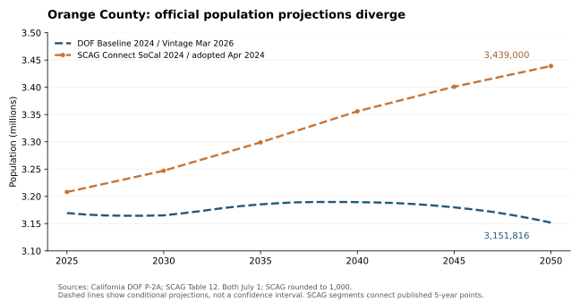

# 需求阶段二：家庭增长与官方未来预测

独立公共研究B；2026-10-11。范围为橙县及Irvine、Lake Forest、Tustin、Aliso Viejo。本文是需求模块的阶段判断，未形成买入／等待结论，也未读取家庭A或旧宏观报告来锚定结论。

## 当前判断

**“未来人口和买家会持续大量流入”不能作为本项目的默认前提。** DOF最新橙县人口情景大致持平，SCAG 2024正式规划更乐观，2026 LDX草案又降低增长展望。与此同时，已入住家庭数仍可增加：平均每户人数下降，会使人口与家庭数走出不同方向。

这些证据支持进一步研究小家庭形成、租买结构与住房供给；尚不足以证明北尔湾四卧无共墙产品有持续新增高购买力买家。县级迁移、城市家庭、工作地点岗位、住房容量不能互相替代，也不能重复计为四份独立需求证据。

## 一、先锁定版本和时间口径

| 系列 | 当前实际版本／性质 | 时间与适用范围 | 使用方法 |
|---|---|---|---|
| DOF P-2A/P-CC | 2024 Baseline，2026-03-13 Vintage | 县级，July 1；2020–2025估计、2026–2070预测 | 人口及出生／死亡／总净迁移情景；2026更新历史起点，未改变2024基准假设 |
| DOF P-4 | Vintage 2025；2025-11-17修订LA及州合计 | 县级，January 1；2010–2025估计、2026–2040预测 | 家庭形成的条件情景，未随P-2A更新到2026；不强行拼入同年人口等式 |
| SCAG Connect SoCal 2024 | 2024-04-04正式采纳 | 县级July 1，千人／千户取整；城市2019/2035/2050 | 正式家庭与岗位规划基准；城市人口附加列不在采纳文件内、未经地方审查 |
| Connect SoCal 2050 LDX | Preliminary，April 2026 | 四城2024/2035/2050；城市表未明确月日 | 征求地方审核的敏感性版本；意见截止2026-11-20，预计2028春采纳，不能写成已批准预测 |

DOF人口方法报告的实际下载字节标题为**2024 Baseline**，SHA-256为`5eb852301c6c7d351b0646c5a93098648ec6289a1809461bb61a4b0d00a133b9`。搜索服务对同URL返回2023 Baseline旧文本；本轮按实际PDF登记，避免沿用缓存。P-2A/P-CC的初次发布说明写2025-09-20，而网页及方法报告写09-30；当前2026-03-13版本一致，初次日期差异保留。

## 二、实际家庭增长：Irvine人口平稳但家庭数增加

DOF E-5 May 2026，同一版本的2025-01-01至2026-01-01：

| 地域 | 2025已入住户 | 2026已入住户 | 增量／增幅 | 人口增量 |
|---|---:|---:|---:|---:|
| Orange County | 1,104,039 | 1,109,903 | +5,864／+0.53% | −11,813 |
| Irvine | 118,260 | 119,437 | +1,177／+1.00% | +92 |
| Lake Forest | 31,288 | 31,411 | +123／+0.39% | −495 |
| Tustin | 27,771 | 27,827 | +56／+0.20% | −475 |
| Aliso Viejo | 19,565 | 19,566 | +1／+0.005% | −474 |

2020-04-01至2026-01-01，Irvine已入住户增加9,430（8.57%）、Lake Forest增加1,683（5.66%）、Tustin增加561（2.06%）、Aliso Viejo增加1（约0.005%）。这不是完整六年窗口，未将其当作六年年化增速。

Irvine最新一年平均每户人数从2.5245降至2.5004。用未取整的家庭人口／已入住户数作对称会计分解：家庭数增加对应约+2,957人，户均人数下降对应约−2,862人，集体住所人口−3人，合计+92。公式为ΔP = 平均户均人数×Δ户数 + 平均户数×Δ户均人数 + Δ集体住所人口，交互项对称分摊。

**这是数量恒等式，不是原因识别。** E-5人口与已入住户共享Housing Unit Method估计体系；不能把等式拆出的两项称为独立需求证据。已入住户包括租客、业主、学生等，并不等于“有孩子的购房家庭”，也不等于年度成交量。Aliso Viejo多年的已入住数几乎固定，是当前估计序列的表现，需ACS等独立资料核对，不能推定真实世界没有家庭迁移。

## 三、橙县未来：人口持平仍可能伴随家庭增加

DOF P-2A当前情景：2025年3,169,463人，2030年3,165,150，2035年3,185,361，2040年3,189,485，2050年3,151,816。2050较2025下降17,647（0.56%）；2026以后的局部高点为2039年3,189,702，低于2020起点。此情景没有持续大幅人口增长。

P-CC假定2025–2026总净迁移−10,401，2029–2030仍为−2,700，**2030–2031转为+1,910**。自然增加在2032–2033转负。后来的净迁入是模型假设，不是已经发生的流入；P-CC此公开表只有总净迁移，不单独报告未来国内／国际净迁移，不据此虚构城市或原籍流向。

独立发布的P-4情景给出2025年1,106,197户，2030年1,136,134，2040年1,184,330：分别增加29,937（2.71%）、78,133（7.06%）。家庭可以在低人口增长下增加，但两个系列时点和Vintage不同，不用“人口÷家庭数”制造统一的未来户均人数。

P-4使用2010–2024的县级训练数据，多类树模型结合2031–2040指数平滑；输入含人口、迁移、住房完工、收入、租买、失业及房价等。方法报告明确这不是住房增长预测、不是最可能结果，也没有建模当下积压需求。不能把使用了机器学习理解为预测已获保证。

SCAG 2024正式规划橙县2050人口为3,439,000，比当前DOF高287,184（约9.1%，以DOF为分母）。两者同为July 1，但基准、假设和发布时间不同；差距用于展示情景敏感性，不平均，不作为统计置信区间。SCAG人口是在家庭规划输入上生成，住房政策和缓解潜在需求的假设已进入模型。

## 四、四城新版规划家庭情景

下表是**2026年4月草案**；Household定义为occupied housing unit。Employment是工作地点岗位数，含工资岗位与自雇，不是居民就业人口。

| 城市 | 2024家庭 | 2035家庭 | 2050家庭 | 2024→2050家庭增长 | 2024→2050岗位变化 |
|---|---:|---:|---:|---:|---:|
| Irvine | 116,683 | 126,586 | 132,986 | +16,303／13.97% | −8,451／−2.67% |
| Lake Forest | 30,981 | 32,632 | 32,530 | +1,549／5.00% | −45／−0.11% |
| Tustin | 27,527 | 32,213 | 31,880 | +4,353／15.81% | −2,521／−4.71% |
| Aliso Viejo | 19,428 | 19,990 | 20,073 | +645／3.32% | +55／+0.25% |

2024正式版本的2050家庭数依次为135,000、31,800、34,000、20,400；新版同终点变化为−2,014、+730、−2,120、−327。Lake Forest仍有上修，不能概括为所有城市都下修。旧版起点2019、新版起点2024，**不能直接比较总增长量／增长率来量化预测修订**。2024正式版本城市未来人口列是未审查附加信息，不能将它们标成正式人口预测。

LDX明确使用一般规划、专项规划、已批准Housing Element的可建容量，并把增长分配到优先发展地区。住房容量、RHNA义务、许可、竣工、出售与入住是不同环节；这里的户数没有指明四卧、无共墙、房龄、产权或出售比例。2024基准也与当前DOF E-5修订值不同，未把119,437实际估计接上132,986草案终点来伪造同系列。

## 五、对研究方案的具体修改与下一验证

1. 用“实际家庭变化→租买／年龄／有孩／收入→买家与融资→目标产品吸收”逐层验证，人口增长只作背景。补ACS B11001/B11005/B25003及年龄、收入／迁移表，带MOE；Irvine规模允许检查1-year，社区优先5-year，窗口不同不混作一年。
2. 官方前瞻单列版本台账与情景，不由县级数字按面积分配北尔湾。社区边界、2020 Census tract/GEOID和Reserve子区需先验收，TAZ也不等于Census tract。
3. 后续供给用项目级容量／批准／开工／完工／可售分层，验证规划兑现率及与目标产品的重合。把规划家庭增长和供给作为相互依赖的机制，不作双重证据计分。
4. 6–12个月依靠成交、库存、挂牌、降价、融资及新房激励；2–3年接项目进度；5–10年才将人口／家庭官方情景作压力测试。暂不赋无依据的概率，不从2050预测推算年度房价。

**验收：**本轮五个标准表175行；八个数值原文件指纹匹配；P-2A/P-CC的51个快照及50个组成等式通过；四城173/62/54/23个TAZ汇总匹配图表；10个历史分解恒等式通过。QA通过表示提取与计算正确，不证明源预测正确。

**仍未完成：**城市家庭年龄／租买／购买力、社区统计叠加、成交试样本、完整学校／项目目录、全市供给及资产定价。成交仍0/20–30，人工0/5，未形成完整公共B。

复算：`python scripts/build_forecast_baseline.py --download`（固定原字节版本；若来源换版则停止并提示登记）及`python scripts/plot_forecast.py`。先运行历史E-5脚本生成基础表。原始工作簿、PDF、页面快照及指纹包存私有Drive；公开仓库仅署名发布本轮统计摘取、代码与分析，不再分发地图或第三方底图。

主要证据：DOF [预测入口](https://dof.ca.gov/Forecasting/Demographics/projections/)、[P-2A](https://dof.ca.gov/media/docs/forecasting/Demographics/projections/P2A_County_Total.xlsx)、[P-CC](https://dof.ca.gov/media/docs/forecasting/Demographics/projections/PCC_Components_of_Change.xlsx)、[P-4](https://dof.ca.gov/media/docs/forecasting/Demographics/projections/P4_HHProjections_B2024.xlsx)、[人口方法](https://dof.ca.gov/media/docs/forecasting/Demographics/projections/Methodology_Report.pdf)、[家庭方法](https://dof.ca.gov/media/docs/forecasting/Demographics/projections/Household-Projections-Methodology.pdf)；SCAG [正式工作簿](https://scag.ca.gov/sites/default/files/2024-05/scag2024-frtp-sed.xlsx)、[技术报告PDF35–36页Table12](https://sustain.scag.ca.gov/sites/default/files/2024-05/23-2987-tr-demographics-growth-forecast-final-040424.pdf)、[2026 LDX四城数据书PDF32页Exhibit12及附录1](https://scag.ca.gov/local-data-exchange)。逐项来源与使用范围见`data/sources.csv`。
