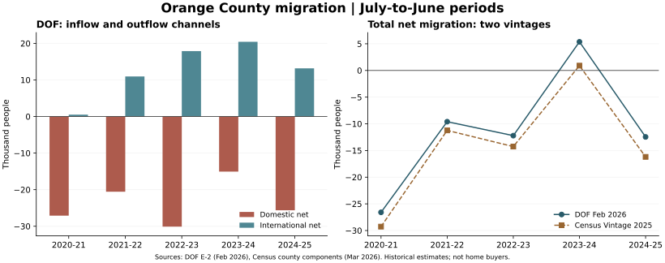

# 需求阶段一：橙县人口与净迁移，社区口径核对

日期：2026-10-11（America/Los_Angeles）。历史人口与迁移形成阶段判断，完整需求研究未完成。

## 目前最支持的判断

“Orange County一直净流入”不符合本轮取得的官方估计。2020年7月至2025年6月的五个完整年度，DOF和Census均显示：国内净迁移每年为负；总净迁移只有2023–2024年度为正，2024–2025又为负。

最近完整年度（2024-07-01至2025-06-30）：
- DOF：国内−25,631，国际＋13,173，总净迁移−12,458；自然增长＋8,288，人口变化−4,170。
- Census：国内−25,357，国际＋9,161，总净迁移−16,196；自然增长＋7,721、残差−45，人口变化−8,520。
- 两套估计的方向一致，具体数量不同。它们是不同官方版本，不能把差异平均成一个“更准的”数字，也不是概率区间。

这削弱了“持续区域净流入会自然托住任何目标房价”的论据，但不等于Irvine、北尔湾或目标四卧缺乏购买需求。县内搬家不改变县级净迁移；居民人数也不识别首付、净值、股票财富及边际买家。县级净流出不能直接推出目标房价将跌。

## 五个完整年度

单位：人。年度为前一年7月1日至所示年份6月30日，不能写成自然年。

| 年度 | DOF国内净迁移 | DOF国际净迁移 | DOF总净迁移 | Census总净迁移 | DOF自然增长 | DOF人口变化 |
|---|---:|---:|---:|---:|---:|---:|
| 2020–2021 | −27,105 | ＋513 | −26,592 | −29,273 | ＋3,725 | −22,867 |
| 2021–2022 | −20,558 | ＋10,955 | −9,603 | −11,232 | ＋7,569 | −2,034 |
| 2022–2023 | −30,105 | ＋17,886 | −12,219 | −14,263 | ＋7,226 | −4,993 |
| 2023–2024 | −15,060 | ＋20,430 | ＋5,370 | ＋903 | ＋8,241 | ＋13,611 |
| 2024–2025 | −25,631 | ＋13,173 | −12,458 | −16,196 | ＋8,288 | −4,170 |



五年累计：DOF国内−118,459、国际＋62,957、总净迁移−55,502；Census国内−144,371、国际＋74,310、总净迁移−70,061。DOF人口累计变化−20,453与迁移不同，因自然增长＋35,049抵消了部分流出。Census人口累计变化−36,660=自然增长＋34,017＋净迁移−70,061＋残差−616。

2023–2024的净流入来自国际流入超过国内流出；最新一年国际净流入减少、国内净流出扩大，方向再次转负。这个模式说明国际迁移假设对未来需求判断重要；本轮没有完成未来预测或识别某政策对橙县的因果贡献。

## 版本、原始文件与复核

- SRC-012：DOF E-2，2026-02-04修订，实际文件名Feb26；工作簿About the Data亦为February 2026。网页Suggested Citation仍写December 2025，不能据此把当前文件误记为旧版。
- SRC-013：同版本DOF E-6。两份表逐项匹配30条记录，属于同一DOF系列的不同呈现，不算独立两份证据。
- SRC-014：DOF修订说明确认2020–2025县级估计因延迟到达的Census数据更新，州总数不变。本轮没有取得December原工作簿，不能声称量化了该次修订幅度。
- SRC-015：Census Vintage 2025，2026年3月发布；CSV采用cp1252解码，按STATE=06、COUNTY=059、SUMLEV=050核对Orange County。不是先前被Missing Key阻断的ACS API。
- SRC-016：Census文件布局明确保留人口变化残差，国际迁移包括美国出生人口及其他组成，不能等同于外国买家。
- 共提取DOF与Census各6个地理单元×5年=60条记录。核对自然增长、迁移加总、人口变化与残差、唯一键、来源指纹，QA通过。
- DOF和Census共享部分行政输入，不能把同方向描述为完全独立抽样复现。没有将两者拼接成一条混合序列。

与上一轮E-5的关系：E-5是1月1日人口／住房估计，E-2与Census是7月1日估计，时间窗口和版本不同。E-5的2025–2026人口变化不能和E-2的2024–2025迁移直接拼成一个等式。城市住房单位法的人口与新增住房也不是两份独立需求证据。

## 周边地区与替代需求

| 2024–2025总净迁移 | DOF | Census |
|---|---:|---:|
| Los Angeles County | −65,819 | −76,146 |
| Orange County | −12,458 | −16,196 |
| Riverside County | ＋4,215 | ＋8,568 |
| San Bernardino County | −4,646 | −3,739 |
| San Diego County | −4,026 | −17,744 |

Riverside的总净流入在两者均为正，但国内净迁移DOF为−989、Census为＋7,758，方向不同，需进一步核对模型／版本与IRS县际流向。不能仅因Riverside流入就断言橙县离开者全部迁往那里；净量不是起点—终点流量。Lake Forest、Tustin、Aliso Viejo均在橙县，县级净迁移更不能识别Irvine与这些城市间的分流。

## 北尔湾与社区口径：已有可复核对应，尚未冻结精细边界

SRC-017/021为现行2024 General Plan入口和Land Use Element；已实际下载95页原文，检查PDF第36页Figure 2。SRC-018为城市GIS图册，SRC-019/020/022为2022年PA 5／9／1地址图。图册仍链接2022地图，不能误写为2026更新地图。

| 社区／产品群 | 官方PA对应 | 本轮确认与限制 |
|---|---|---|
| Stonegate | PA 9中的9B及9C2 | 2024 Figure 2明确列示；PA9也含Woodbury等，整PA不能当Stonegate |
| Woodbury | PA9A | 同Figure 2；不与Stonegate重复加总 |
| Woodbury East | PA9C1 | 同Figure 2；街区边界与Census tract待叠加 |
| Eastwood Village | PA5的子区域 | PA5地图有Eastwood ES、Eastwood Neighborhood Park和相关街路；不等于整个PA5 |
| Northwood Pointe／官方Northwood Point | PA5 | 官方PA名和市场社区范围分别登记；与Eastwood共用父PA |
| Northwood | PA8 | 官方规划区对应，旧社区市场称谓仍需范围核对 |
| Orchard Hills | PA1 | 父规划区确认，含不同子区与产品 |
| Reserve at Orchard Hills | PA1内子区待细分 | 不将整个PA1替代Reserve；本轮未核实Reserve的独立polygon／Census tract |
| Portola Springs | PA6 | 官方父PA确认；分期／社区精细边界待核 |
| Great Park | 现行General Plan PA51 | 旧GIS域另有PA30，先登记版本差异，不把两个标签重复相加 |
| Cypress Village | PA40 | 作为全市替代筛查；正式北尔湾是否纳入与核心口径分别处理 |

特别注意：城市GIS字段TRACT与PA Tract Maps中的TR.编号指土地开发／登记tract；不是Census statistical tract GEOID。两类编号不能直接join。Northwood High School在GIS中位于PA1，也说明学校名字、校区服务范围和社区边界不能互相代替。

本轮建立11行community_pa_crosswalk_v0_2.csv，记录父PA、子区、原始依据和边界状态。可用于检索与避免混样，不能拿父PA人口机械按面积分给社区。正式polygon、Census tract交叉表、跨界比例与历史边界变化未完成；尚不能报告北尔湾净迁移或目标家庭规模。

## 成交入口与阶段验收

成交可行性继续未通过：0/20–30笔，人工复核0/5笔；没有把人口数据或学校地块算入。已检查的GIS与公开登记索引缺完整价格／户型／挂牌史，不能保证目标成交覆盖。后续优先核明确允许研究使用的导出或授权底稿，并保留代理字段清单；原始MLS导出不公开。

人口净迁移的县级历史核心问题已获得方向、数值和反例；城市／社区家庭形成、官方预测、购买力、学校与供给等尚未完成。未接入A，未作家庭最终买／等建议。

## 下一步与会改变判断的证据

1. 取得DOF当前县级预测、SCAG现行预测与Irvine LDX文件，区分预测家庭、人口、迁入及供给容量；本轮历史流出不自动外推未来。
2. 取得城市家庭结构与迁入者收入／现有房屋净值等证据，并完成Census tract到社区叠加；县内集中与高购买力可使目标需求强于县总量。
3. 推进明确授权的成交试样本与同品质租赁；否则不能把迁移人数换算成目标价位买家数量。
4. 更新触发：新县级版本改变迁移方向或规模、国内流出持续减弱、国际流入路径改变、Irvine家庭增长或实际目标买家证据与县背景相反。

复算命令：
```bash
python scripts/build_demographic_components.py --download
python scripts/plot_migration.py
```
